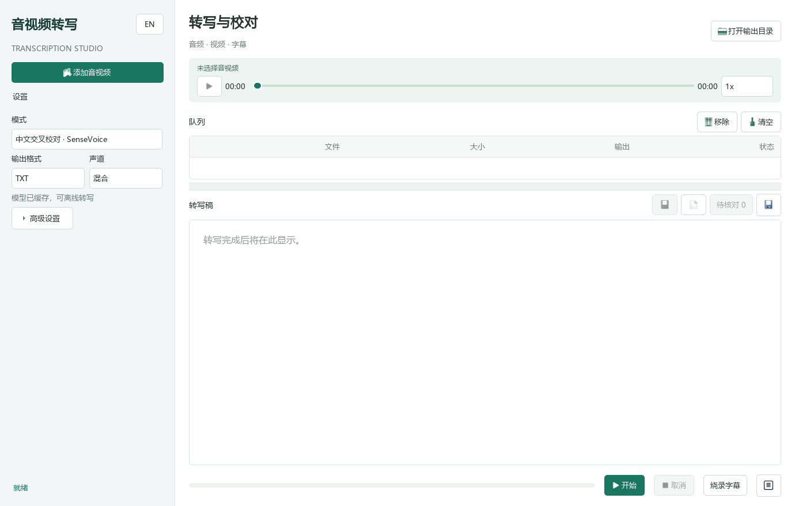

# Video Text Extractor


把音视频里的语音、字幕轨或画面文字提取成可编辑文本。

默认使用本地 SenseVoice 转写中文录音，不需要 API Key。其他语言或句子级 SRT/VTT 字幕可切换到 Whisper；也保留 OpenAI API、内嵌字幕提取和画面 OCR。

> 适合课程视频、会议录屏、英文视频转英文稿、字幕文件制作、以及把屏幕里的字幕/幻灯片文字提取出来。

## Highlights

| 能力 | 说明 |
| --- | --- |
| 桌面软件体验 | PySide6 浅色工作台，双击启动，拖拽音视频，队列批量处理 |
| 本地优先 | 默认 SenseVoice 中文转写，录音不离开电脑，模型下载后可复用 |
| 6 种模式 | SenseVoice、Whisper、OpenAI API、Embedded Subtitles、Visual OCR、Auto |
| 多语言 | 支持自动识别，也可指定 `en`、`zh`、`ja`、`ko`、`es`、`fr` 等语言 |
| 多格式输出 | `TXT`、`SRT`、`VTT`、`JSON` |
| 批量和历史 | 支持 1-4 个任务并行、实时日志、输出预览、历史记录恢复 |
| 字幕工作流 | 可生成字幕文件，也可把 SRT 硬烧进视频 |

## Quick Start

安装依赖：

```powershell
python -m pip install -r requirements.txt
python tools/setup_sensevoice.py
```

启动桌面版：

```powershell
python video_text_gui.py
```

也可以直接双击：

```text
start_video_text_gui.bat
```

中文录音：保持默认 SenseVoice 模式，添加音视频后直接开始，结果为 TXT 待校对稿。模型首次配置约下载 239MB。

需要把模型放到 D 盘时，首次配置可改为：

```powershell
python tools/setup_sensevoice.py --model-dir D:/VideoTextModels
```

这个选择会保存在本机，下次双击启动仍然使用该目录。

英语视频转英语文字：

1. 模式选 `本地语音转写 / Local transcription`（Whisper）
2. 语言选 `English (en)`
3. 任务选 `Transcribe`
4. 输出选 `TXT` 或 `SRT`
5. 点击开始

## Desktop App

桌面版是推荐入口。它会帮你处理文件队列、输出路径、模型参数和运行日志，适合不想每次敲命令的人。



左侧集中设置语言、模型、输出格式与声道；文件类型、输出目录、翻译任务、并行数和运行环境放在高级设置里。正文上方可播放原始音频、拖动定位和调速（0.5–2 倍），双击带时间戳的行可跳到对应位置。日志和历史默认收起，可由右下角按钮展开。

支持直接添加 M4A、MP3、WAV、FLAC、AAC、OGG、OPUS、WMA 音频。切换文件会保留未保存的编辑草稿，点击保存才写入当前文件。草稿只在本次运行中保留。

不同目录的同名文件会分配不同的输出文件名。重复转写时，如果输出已存在，会新增编号文件，保留上一版。字幕烧录在后台运行，可取消；输出已存在时也自动使用新文件名。

### 模糊录音与校对

本地转写可选混合、左、右声道；轻度人声增强默认关闭，适合与原音版本对比。专业术语会作为本地或云端模型的提示，建议只填写录音中确实出现的词。

桌面版和命令行默认选择 SenseVoice；切换到 Whisper 时，初始模型为 small，未缓存时约下载 461MB。本地解码直接使用 ffmpeg，不再复制一个 ffmpeg.exe 到输出目录。

模型目录由本机 `.model_storage.json` 的 `directory` 统一指定，也可使用 `VIDEO_TEXT_MODEL_DIR` 环境变量覆盖。Whisper 放在其 `whisper/` 子目录，SenseVoice 放在 `sensevoice/`。未配置时使用项目 `.video_text_cache/`；配置文件不会提交到 Git。高级设置里可查看当前模型目录。使用 `--model-dir D:/VideoTextModels` 配置后，两个引擎的后续下载和加载都会使用 D 盘。

本地转写优先使用确定性解码；遇到异常重复或低可信结果时使用有限的温度回退重试，保留正常静音阈值，并关闭跨片段文本续接。每份输出旁会生成 `.review.json`，记录模型提示需要回听的片段；点击“待核对”可定位播放。这些提示不是准确率评分，未标记内容仍可能识别有误。增强、术语提示可能改善或恶化结果，应与原音版本比较。

导出无时间戳副本会另存为 `*_reading.txt`，保留原词句，不生成或补写答辩内容；原始转写不受影响。

### 中文交叉校对

默认模式“中文交叉校对 · SenseVoice”使用独立的本地识别引擎，也可与 Whisper 互相核对。它目前固定中文、输出 TXT，每段时间戳表示约 20 秒的音频区间，不是句子级对齐。所有片段都会标为待人工核对；没有识别出文字的区间会明确保留占位，不会悄悄消失。

完整依赖安装已包含 SenseVoice。也可选择只将该引擎的依赖装到项目缓存：

```powershell
python -m pip install --upgrade --target .video_text_cache/asr-deps -r requirements-sensevoice.txt
python tools/setup_sensevoice.py
```

下载约 239MB 模型并校验哈希；识别时无需上传录音。实现依据：[Sherpa-ONNX SenseVoice 文档](https://k2-fsa.github.io/sherpa/onnx/sense-voice/python-api.html)。

### 操作流程

1. 添加文件：点击添加音视频，或者把 `.m4a` / `.mp3` / `.wav` / `.mp4` / `.mkv` 等文件拖进窗口。
2. 选择模式：中文保持默认 SenseVoice；多语言或字幕可选 Whisper，另外保留云端、内嵌字幕、OCR 和 Auto。
3. 选择语言：SenseVoice 固定中文；Whisper 可自动识别或指定 `en`、`zh` 等。
4. 选择模型：SenseVoice 使用固定 INT8 模型；Whisper 可选择 small 等模型。准确率取决于语言和录音质量。
5. 选择输出：SenseVoice 固定 TXT；Whisper 支持 TXT、SRT、VTT、JSON。
6. 开始队列：运行中界面会锁住关键设置，避免任务和输出路径错乱。

### 回归验证

`python -m unittest discover -s tests -v` 验证音频支持、输出命名、预览草稿、跳过任务、真实并行子进程队列、字幕烧录及切片返回缺时间戳等边界情况。真实字幕烧录测试使用本地 ffmpeg，不调用转写 API，也不下载 Whisper 模型。

### 模式怎么选

| 模式 | 适合场景 | 额外依赖 |
| --- | --- | --- |
| `SenseVoice` | 中文录音转 TXT，默认模式；区间时间戳供人工回听 | `sherpa-onnx`、SenseVoice 模型、ffmpeg |
| `Local Whisper` | 多语言转写、翻译成英文、SRT/VTT/JSON | `openai-whisper`、`imageio-ffmpeg` |
| `OpenAI API` | 想用远程 API 转写 | `OPENAI_API_KEY` |
| `Embedded subtitles` | 视频文件本身带字幕轨 | `ffmpeg` 和 `ffprobe` |
| `Visual OCR` | 字幕或文字是画面的一部分，可在界面里指定 OCR 语言 | `tesseract` 和对应语言包 |
| `Auto (best)` | 先试字幕轨，再回退到语音转写 | 取决于命中的模式 |

## Command Line

GUI 之外，所有核心能力也能用命令行调用。

中文转写（默认 SenseVoice）：

```powershell
python video_text_extractor.py recording.m4a --audio-channel left -o transcript.txt
```

本地 Whisper 转写：

```powershell
python video_text_extractor.py video.mp4 --mode whisper --whisper-model base --language en -o transcript.txt
```

自动识别语言：

```powershell
python video_text_extractor.py video.mp4 --mode whisper --whisper-model base -o transcript.txt
```

导出 SRT 字幕：

```powershell
python video_text_extractor.py video.mp4 --mode whisper --format srt -o subtitles.srt
```

导出 VTT 字幕：

```powershell
python video_text_extractor.py video.mp4 --mode whisper --format vtt -o subtitles.vtt
```

导出 JSON 元数据：

```powershell
python video_text_extractor.py video.mp4 --mode whisper --format json -o transcript.json
```

翻译成英文：

```powershell
python video_text_extractor.py video.mp4 --mode whisper --whisper-task translate -o translated.txt
```

提取内嵌字幕：

```powershell
python video_text_extractor.py video.mp4 --mode subtitle -o subtitles.srt
```

画面 OCR：

```powershell
python video_text_extractor.py video.mp4 --mode ocr --ocr-interval 2 -o ocr.txt
```

只检查环境，不执行转写：

```powershell
python video_text_extractor.py video.mp4 --dry-run
```

## Options

| 参数 | 说明 |
| --- | --- |
| `--mode` | `whisper`、`audio`、`subtitle`、`ocr`、`auto` |
| `--language` | 语言代码，例如 `en`、`zh`、`ja`、`ko`；语音模式也接受 `en-US` 这类地区码，会取主语言；不传则自动识别 |
| `--whisper-model` | `tiny`、`base`、`small`、`medium`、`large-v3`、`turbo` |
| `--whisper-task` | `transcribe` 原语言转写，`translate` 翻译成英文 |
| `--format` | `text`、`srt`、`vtt`、`json` |
| `--ocr-interval` | OCR 每隔多少秒抽一帧 |
| `-o`, `--out` | 输出文件路径，父目录会自动创建 |
| `--dry-run` | 只检测依赖和配置 |

## Dependencies

Python 依赖写在 `requirements.txt`：

| 包 | 用途 |
| --- | --- |
| `PySide6` | 桌面 GUI |
| `openai-whisper` | 本地语音转写 |
| `imageio-ffmpeg` | 提供可复用的 ffmpeg 可执行文件 |
| `openai` | OpenAI API 转写 |

可选系统工具：

| 工具 | 什么时候需要 |
| --- | --- |
| `ffmpeg` | 提取视频内嵌字幕轨、抽帧 OCR、音频切片 |
| `ffprobe` | 推荐安装，用于更准确地检测视频内嵌字幕轨；没有时会回退到 `ffmpeg` |
| `tesseract` | Python OCR 模式识别画面文字 |
| Chrome / Edge | Node.js 版画面 OCR 解码视频 |

说明：本地 Whisper 和部分视频处理会自动复用 `imageio-ffmpeg` 自带的 ffmpeg；如果通过 winget 安装 Gyan FFmpeg，程序也会自动查找 winget 安装目录里的 `ffmpeg.exe` / `ffprobe.exe`。`ffprobe` 不是硬依赖，但装完整 FFmpeg 套件会让字幕轨检测更稳。

## Visual OCR

Python CLI 的 `--mode ocr` 使用系统 `tesseract`。默认会优先使用 `chi_sim+eng`，如果只安装了英文语言包则自动退到 `eng`，也会识别 `TESSDATA_PREFIX` 或项目根目录 `tessdata` 里的语言包。自定义 OCR 语言可以写 `chi_sim+eng`，也可以写 `zh+en`，程序会映射成 Tesseract 语言包名。项目里还带一个 Node.js 版 OCR 工具，适合截取视频底部字幕区域或整帧画面：

```powershell
npm install
node local_video_ocr.js video.mp4 --interval 1 -o ocr_output.txt
```

识别整张画面：

```powershell
node local_video_ocr.js video.mp4 --full-frame --interval 3 -o full_ocr.txt
```

只识别底部字幕区域：

```powershell
node local_video_ocr.js video.mp4 --crop-bottom 0.42 --lang chi_sim+eng -o subtitle_ocr.txt
```

Node 版 OCR 的 `--lang` 也支持 `zh+en`、`EN`、`en-US`、`zh-TW` 这类别名写法，会自动映射到 Tesseract 语言包名。

## Output

默认输出目录是项目下的 `outputs` 文件夹。桌面版会按模式和语言自动生成文件名：

```text
video_transcript_en.txt
video_transcript_zh.srt
video_subtitles.srt
video_ocr.txt
```

历史记录保存在 `.transcribe_history.json`，已加入 `.gitignore`。视频、输出文件、缓存目录也默认不会提交到 Git。

## Troubleshooting

### 英语视频转英语稿为什么不要选 Translate？

`Transcribe` 是按原语言转写，英语视频会输出英文稿。`Translate to English` 是把非英语语音翻译成英文。

### subtitle 模式失败怎么办？

这个模式只处理“视频文件里真正存在的字幕轨”。如果字幕只是画面里看得见的字，用 OCR；如果是语音内容，用 Whisper。

### OCR 模式失败怎么办？

确认已经安装 `tesseract` 和语言包。英文常用 `eng`，简体中文常用 `chi_sim`，混合识别可用 `chi_sim+eng`。Windows 安装程序通常只自带 `eng` / `osd`，中文 OCR 需要把 `chi_sim.traineddata` 放进 Tesseract 的 `tessdata` 目录，或放进项目根目录的 `tessdata` 文件夹。

### 第一次转写为什么慢？

Whisper 首次会下载模型。模型越大越慢，越吃 CPU/GPU。短视频可先试 `base`，长视频可先用 `tiny` 或 `base`。

### OpenAI API 模式怎么设置 Key？

```powershell
$env:OPENAI_API_KEY="你的 API Key"
python video_text_extractor.py video.mp4 --mode audio --language en -o transcript.txt
```

## Project Structure

```text
video_text_gui.py          Desktop GUI
video_text_extractor.py    Core CLI engine
local_video_ocr.js         Node.js visual OCR helper
start_video_text_gui.bat   Windows launcher
requirements.txt           Python dependencies
package.json               Node.js OCR dependencies
LICENSE                    MIT license
```

## License

MIT. See [LICENSE](LICENSE).
